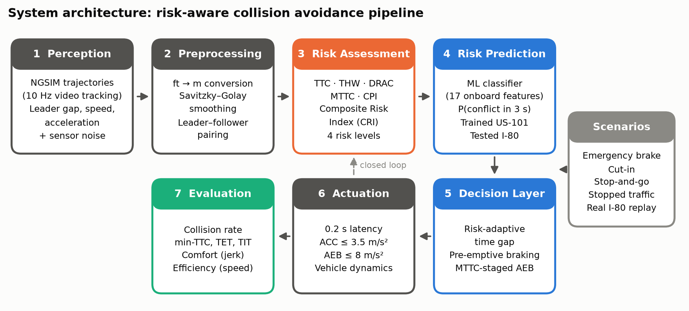
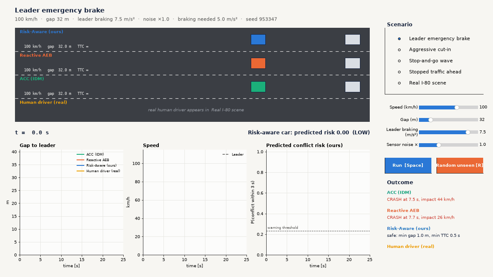
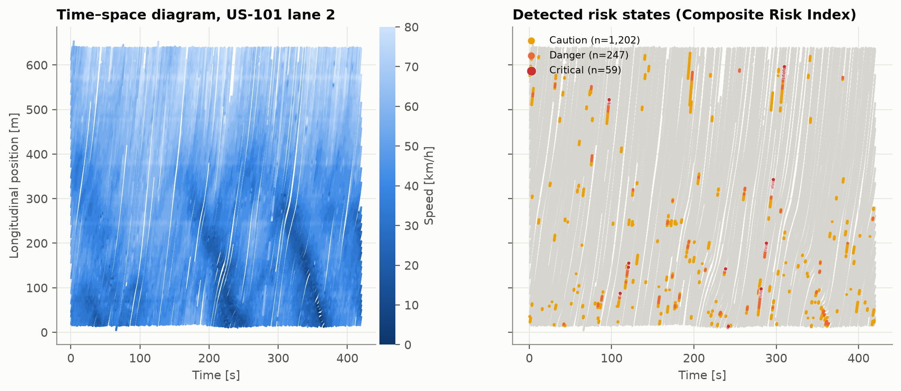
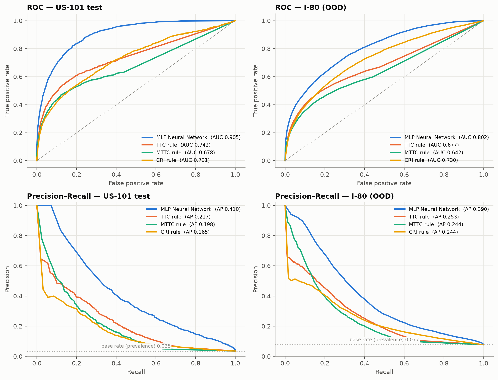
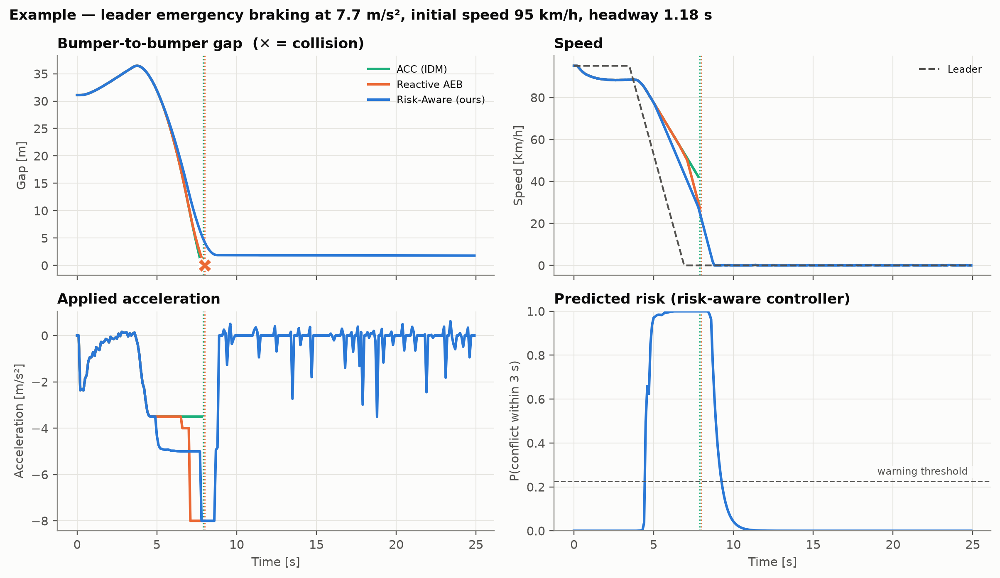
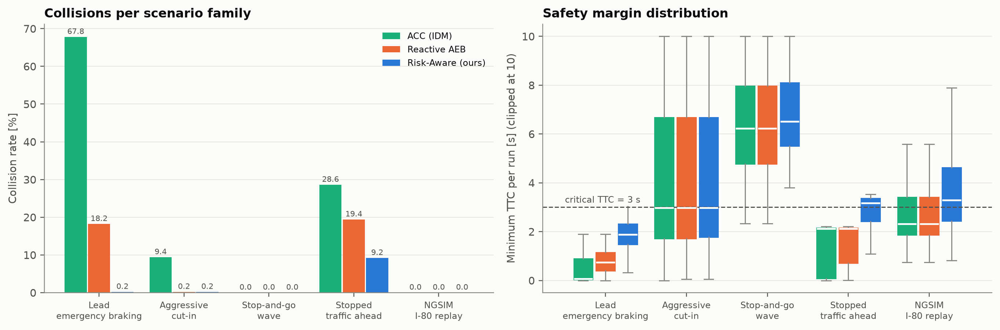

# Risk-Aware Autonomous Driving & Collision Avoidance System

An end-to-end system that **measures**, **predicts** and **avoids** collision risk for an
autonomous vehicle. It is built and evaluated on real traffic: the public
**NGSIM** vehicle-trajectory dataset from the U.S. Federal Highway Administration.

**Scope: SAE Level 2 functionality, in simulation and on a 1:10 RC car.** The vehicle controls speed **and**
steering and makes its own decisions:
- **Speed and braking:** cruise, follow, slow down, stop, and emergency-brake, with ML-predicted risk 3 s ahead.
- **Steering:** keep its lane and follow curved roads and turns.
- **Lane changes:** overtake, with a lane change only after a TTC safety check, and abort if the gap closes.
- **Rules of the road:** stop at red or yellow lights and give way to pedestrians.

The same decision logic drives a **1:10 RC car** (`rc_car/`).

```
Perception ─► Preprocessing ─► Risk Assessment ─► Risk Prediction ─► Decision ─► Actuation
(NGSIM, 10 Hz)  (smoothing,      (TTC, THW, DRAC,    (ML: P(conflict    (risk-adaptive  (latency,
                 pairing)         MTTC, CPI, CRI)     within 3 s))       IDM + MTTC-AEB)  limits)
```



## Headline results

**Conflict anticipation** (predict a critical conflict within 3 s from a currently safe state):

| Model | US-101 ROC-AUC | US-101 PR-AUC | I-80 (unseen) ROC-AUC | I-80 PR-AUC |
|---|---|---|---|---|
| TTC rule | 0.741 | 0.217 | 0.677 | 0.253 |
| MTTC rule | 0.678 | 0.198 | 0.642 | 0.244 |
| CRI rule | 0.731 | 0.165 | 0.730 | 0.244 |
| **MLP Neural Network (deployed)** | 0.904 | 0.406 | 0.804 | 0.393 |

**Closed-loop collision avoidance** (collision rate / median minimum TTC):

| Scenario | ACC (IDM) | Reactive AEB | Risk-Aware (ours) | Human driver |
|---|---|---|---|---|
| Lead emergency braking | 67.8% / 0.07 s | 18.2% / 0.74 s | **0.8% / 1.74 s** | n/a |
| Aggressive cut-in | 9.4% / 2.97 s | 0.2% / 2.97 s | **0.2% / 2.97 s** | n/a |
| Stop-and-go wave | 0.0% / 6.23 s | 0.0% / 6.23 s | **0.0% / 6.41 s** | n/a |
| Stopped traffic ahead | 28.6% / 2.12 s | 19.4% / 2.12 s | **9.2% / 3.23 s** | n/a |
| NGSIM I-80 replay | 0.0% / 2.31 s | 0.0% / 2.31 s | **0.0% / 3.35 s** | 0% / 1.93 s |

**Level-2 driving** (30 unseen random variants per scenario, risk-aware vs reactive planner):

| Scenario | Collisions (ours / reactive) | Lane changes per run | Red-light violations | Lane-keeping RMS |
|---|---|---|---|---|
| Highway: overtake slow truck | 0% / 0% | 2.9 | – | 4.5 cm |
| Highway: aggressive cut-in | 0% / 0% | 1.2 | – | 3.8 cm |
| Highway: sudden stop, lanes blocked | **0% / 47%** | 0.2 | – | 1.9 cm |
| Urban: turns, traffic light, pedestrian | 0% / 0% | 0 | 0 | 6.4 cm |
| RC track (1:10 scale) | 0% / 0% | 0 | 0 | 2.4 cm |

**RC autopilot** (simulated car, camera lane detection, ultrasonic sensor): 6 scenarios, 0 collisions,
lane-keeping RMS 3.6–4.5 cm in a 40 cm lane.

The full write-up is in **[reports/Project_Report.docx](reports/Project_Report.docx)**.
All numbers come from `reports/metrics.json`, `reports/simulation_results.json`, `reports/av_results.json`
and `reports/rc_results.json`.

## Dataset

| | |
|---|---|
| Source | U.S. DOT / FHWA **Next Generation Simulation (NGSIM)**, [data.transportation.gov/d/8ect-6jqj](https://data.transportation.gov/d/8ect-6jqj) |
| Licence | Public domain, no registration |
| Collection | Overhead video, every vehicle tracked at 10 Hz (position, speed, acceleration, lane, leader/follower) |
| Training site | **US-101**, Los Angeles, 15 Jun 2005, 07:50–08:05 (≈1.1 M records) |
| Test site (unseen) | **I-80**, Emeryville CA, 13 Apr 2005, 16:00–16:14 (≈1.15 M records) |

`src/download_data.py` fetches exactly these windows from the open API, so the project is fully reproducible.

## Method in brief

1. **Preprocessing.** Convert ft → m, smooth positions with a Savitzky–Golay filter and derive speed and acceleration
   (raw NGSIM accelerations are noisy), trim filter edges, and pair each follower with its same-lane leader.
2. **Risk assessment.** Compute TTC, time headway, DRAC, Modified TTC, Crash Potential Index and a
   **Composite Risk Index** (CRI) with four levels: Safe / Caution / Danger / Critical.
3. **Risk anticipation.** From a state that is *currently safe*, predict whether a critical conflict
   (TTC < 3 s or DRAC > 3.35 m/s²) occurs within the next **3 s**. Models: Logistic Regression, Random Forest,
   MLP and Gradient Boosting, compared against TTC, MTTC and CRI threshold rules. Splits are grouped by
   vehicle, and the I-80 site is held out completely.
4. **Collision avoidance.** Three controllers are compared in a vectorised closed-loop simulator with sensor noise,
   0.2 s actuation delay and realistic braking limits:
   * **ACC (IDM)**: Intelligent Driver Model, braking limited to 3.5 m/s² (ISO 15622)
   * **Reactive AEB**: ACC plus a staged emergency brake on TTC (Euro NCAP-style)
   * **Risk-Aware (ours)**: risk-adaptive time gap, pre-emptive graded braking, and an AEB on min(TTC, MTTC)
5. **Scenarios.** 4 × 500 Monte-Carlo stress tests (leader emergency braking, cut-in, stop-and-go, stopped traffic)
   plus 200 **real I-80 leader trajectories**, where the real human driver serves as a reference.

## Project structure

```
├── run_pipeline.py            # one command: download → preprocess → train → simulate → figures → report
├── requirements.txt
├── src/
│   ├── config.py              # all paths, thresholds and hyper-parameters
│   ├── download_data.py       # NGSIM download (Socrata API)
│   ├── preprocess.py          # cleaning, smoothing, leader–follower pairs, SSMs
│   ├── risk_metrics.py        # TTC, THW, DRAC, MTTC, CPI, CRI, TET, TIT
│   ├── features.py            # features + future-conflict labels
│   ├── train_models.py        # training, evaluation, model selection
│   ├── collision_avoidance.py # controllers, simulator, scenarios
│   ├── visualize.py           # report figures
│   ├── estimation.py          # range / range-rate filter + alert confirmation logic
│   ├── report.py              # generates reports/Project_Report.docx
│   └── av/                    # Level-2 stack
│       ├── vehicle.py         #   kinematic bicycle model, actuator limits
│       ├── road.py            #   paths, multi-lane roads, Frenet frames, traffic lights
│       ├── tracking.py        #   Pure Pursuit / Stanley, curve speed limits
│       ├── longitudinal.py    #   risk-aware speed control (ML risk + MTTC AEB + DRAC gate)
│       ├── planner.py         #   behaviour planner: lane changes, lights, pedestrians, AEB
│       ├── perception.py      #   noisy object list
│       ├── agents.py          #   traffic cars (IDM, scripted events), pedestrians
│       ├── world.py           #   closed-loop 2-D simulator + metrics
│       ├── scenarios.py       #   highway / urban / RC-track scenarios (+ random variants)
│       └── evaluate.py        #   batch evaluation on unseen variants
├── demo.py                    # visual simulator: speed control on one lane
├── demo2d.py                  # visual simulator: full Level-2 driving, top-down
├── webcam_demo.py             # live webcam collision warning
├── rc_car/                    # RC-car autopilot (see rc_car/HARDWARE.md)
│   ├── main.py                #   run on sim / Arduino / Raspberry Pi
│   ├── autopilot.py           #   decisions + control (hardware independent)
│   ├── lane_detection.py      #   bird's-eye view, lane lines, stop line, light card
│   ├── hal.py                 #   SimCar / SerialCar / PiCar
│   ├── calibrate.py           #   servo, ESC, camera, colours, sensor
│   ├── evaluate.py            #   simulated RC results for the report
│   ├── arduino/rc_actuator/   #   Arduino firmware (servo, ESC, sonar, failsafe, E-stop)
│   └── HARDWARE.md            #   parts, wiring, track, calibration, test procedure
├── tests/                     # 26 unit tests (core, Level-2 stack, RC car)
├── models/risk_model.joblib   # deployed risk model
├── reports/
│   ├── Project_Report.docx    # full report
│   ├── figures/               # all figures (PNG, 220 dpi)
│   ├── metrics.json           # prediction results
│   └── simulation_results.json
└── data/                      # raw + processed data (created by the pipeline)
```

## How to run

```bash
python -m venv .venv
.venv\Scripts\activate            # Windows   (Linux/macOS: source .venv/bin/activate)
pip install -r requirements.txt
python run_pipeline.py            # ~15–20 min the first time (download ≈210 MB)
python -m pytest -q               # 26 unit tests
```

Already downloaded the data? Use `python run_pipeline.py --skip-download` (≈6 min), or add `--skip-av` to skip
the Level-2 and RC evaluation (≈2 min).

## Level-2 driving simulator (`demo2d.py`)

```bash
python demo2d.py                          # top-down simulator window
python demo2d.py --scenario urban_route   # start with the urban route
python demo2d.py --evaluate 30            # batch test on 30 unseen variants per scenario
python demo2d.py --save drive.gif         # render a scenario to a GIF
```

A bird's-eye view follows the car. It shows lanes, traffic, traffic lights, zebra crossings, pedestrians and the
car's planned path. The side panel shows the planner's state (CRUISE, FOLLOW, LANE CHANGE, STOP: RED LIGHT,
YIELD: PEDESTRIAN, EMERGENCY BRAKE …) and a **decision log** with the reason for every decision, for example
*"Left lane change rejected: car behind 12 m closing at 6 m/s (TTC 2.0 s)"*.
**Random unseen** (R) generates a new variant. **Controller** (C) switches between the risk-aware and the
reactive planner.

## RC car (`rc_car/`)

```bash
python -m rc_car.main --backend sim --view --realtime        # simulated car, no hardware needed
python -m rc_car.main --backend serial --port COM5 --view    # real car: laptop/Pi + Arduino
python -m rc_car.main --backend pi --stream 8080 --autostart # real car: Raspberry Pi only
```

The car follows a two-tape lane with its camera and keeps a gap to the car ahead with an ultrasonic sensor.
It emergency-brakes with the same TTC thresholds as the full-size car, stops and waits at red stop lines, and
obeys red and green cards. It stops safely if a sensor fails or the lane is lost. **Before driving a real car,
read [rc_car/HARDWARE.md](rc_car/HARDWARE.md)**. It covers parts, wiring, track building, calibration and a
step-by-step safe test procedure.

## Live visual demo (`demo.py`)



```bash
python demo.py                    # interactive simulator window
python demo.py --batch 300        # stress test on 300 brand-new random scenarios per family
python demo.py --save demo.gif    # render one run to an animated GIF
```

* **Simulator window.** Three identical leaders drive in three lanes. Each ego car is driven by a different
  controller (ACC, reactive AEB, risk-aware), so you can watch which one brakes in time. Live plots show gap,
  speed and the predicted conflict risk.
* **Unseen scenarios.** Pick a scenario, set speed, gap, leader braking and sensor noise with the sliders, and
  press **Run** (Space). **Random unseen** (R) draws a new random scenario. **Real I-80 scene** replays a random
  clip from the unseen I-80 freeway, with the real human driver in the bottom lane.
* **Batch mode.** Runs hundreds of new random scenarios (a fresh seed, wider ranges than the report: up to
  140 km/h, braking up to 9 m/s²). It prints collision rates and saves `reports/figures/unseen_stress_test.png`.
  Physically unavoidable runs (more than 8 m/s² needed) are reported separately.

## Live webcam practical (`webcam_demo.py`)

The laptop camera acts as the car's forward sensor. Walk towards it, or move a toy car towards it, and the
project's risk pipeline runs live on every frame:

```bash
python webcam_demo.py                 # face mode: walk towards the camera
python webcam_demo.py --color         # colour mode: click the object to track (e.g. a toy car)
python webcam_demo.py --width 0.10    # real width of your object in metres (default 0.10)
```

* Distance comes from the object's apparent size. Approach speed and acceleration come from a 1-second
  polynomial fit, with deadbands so that pixel jitter does not look like motion.
* TTC, Modified TTC, DRAC and the Composite Risk Index are computed with `src/risk_metrics.py`.
* The staged AEB decision on min(TTC, MTTC) uses the thresholds in `src/config.py` (warning 2.6 s, partial
  brake 1.6 s, emergency brake 0.9 s). A level is raised after a short confirmation and lowered after a hold,
  as in real AEB systems.
* Keys: click = track that colour, **M** = face/colour mode, **K** = calibrate (hold the object at 0.5 m),
  **S** = screenshot, **Q** = quit. On exit a CSV log and a plot of the session are saved to `reports/`.
* Scope: this demonstrates the physics risk layer and the AEB logic on a live sensor. The ML predictor was
  trained on highway trajectories, so it is evaluated in the simulator (`demo.py`), not at walking speed.

## Figures

| | |
|---|---|
|  |  |
|  |  |

## Limitations

The ML risk model covers rear-end conflicts; lane-change safety uses rule-based TTC and gap checks. Level-2
functions are validated in a 2-D simulator with scripted traffic and on a simulated RC car. Physical RC tests
still have to be run (protocol in `rc_car/HARDWARE.md`). It is not a road-legal driving system. NGSIM dates
from 2005 and contains some tracking noise, and critical events are defined by surrogate thresholds, not real
crashes. See Chapters 6–7 of the report.

## References (key)

Hayward (1972) TTC · Minderhoud & Bovy (2001) TET/TIT · Ozbay et al. (2008) MTTC · Cunto & Saccomanno (2008) CPI ·
Treiber et al. (2000) IDM · Punzo et al. (2011) NGSIM data quality · FHWA NGSIM (2016).
